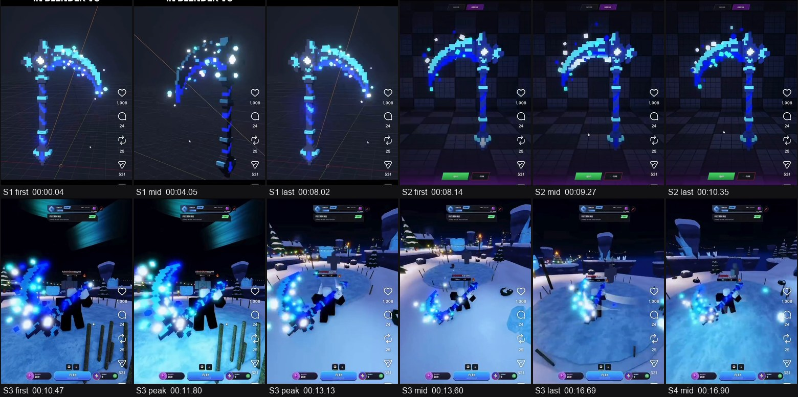
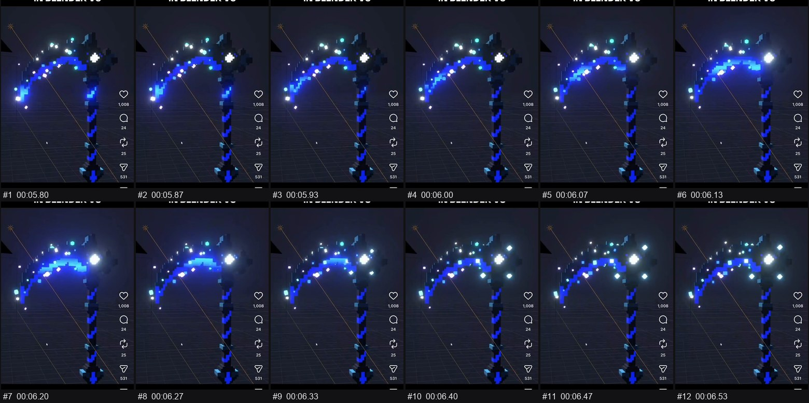
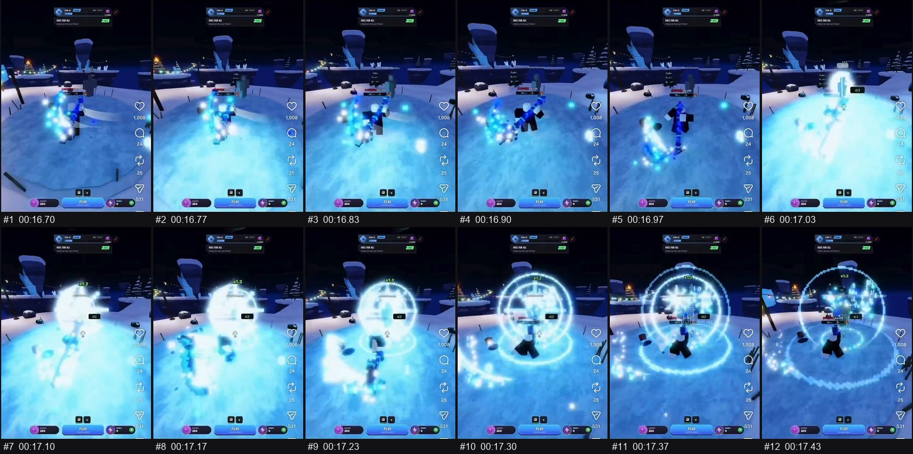

# วิเคราะห์: เคียว Voxel เรืองแสง "In Blender vs In Game"

## สรุปสั้น

คลิปนี้เป็นการอัดหน้าจอมือถือจากโพสต์โซเชียลของบัญชี `grappleknockout` เปรียบเทียบอาวุธเคียว voxel สีฟ้า 3 ช่วง: ใน Blender, ในหน้าโชว์ไอเทม และในเกมจริง

ผมทำส่วนอาวุธและเอฟเฟกต์ได้ราว 85–90% ของที่เห็น (ประเมินคร่าวๆ) โดยไม่ต้องใช้โมเดลจาก AI เลย ส่วนท่าเหวี่ยงของตัวละครและเกมทั้งเกมเป็นงานคนละระดับ งานแรกที่ควรเริ่มคือสร้างอาวุธ voxel ออริจินัลของคุณใน Blender พร้อมพัลส์พลังงาน



## ข้อมูลคลิป

| รายการ | ค่า |
|---|---|
| ขนาดและความยาว | 576×1252 แนวตั้ง, 22.87 วินาที, 30 fps |
| ฉากจริง | 3 ฉาก + ตอนจบที่ปัดเปิดแผงควบคุมมือถือ |
| เสียง | มีเสียงตลอดคลิป ฟังไม่ได้ว่าเป็นเพลงแบบไหน |
| สีเด่น | `#142352` `#465ea1` `#527fc4` `#67b9e9` `#96d9f5` |
| คุณภาพ | ถูกบีบอัดซ้ำ รายละเอียดเล็กและ fps จริงของเกมจึงเชื่อไม่ได้ |

สคริปต์นับได้ 7 ช็อต แต่ผมตรวจเฟรมแล้วเหลือ 3 ฉากจริง: คัตที่ 16.77, 17.03 และ 18.27 วินาทีเกิดจากแสงขาวของสกิล ไม่ใช่การตัดภาพ

## ในคลิปมีอะไร

| ช่วงเวลา | เกิดอะไรขึ้น | จุดที่น่าสนใจ |
|---|---|---|
| 0.00–8.10 | เคียวใน viewport ของ Blender กล้องหมุนรอบ | พื้นมืด เห็นเส้นกริดและแกน จึงน่าจะเป็นการอัดจาก viewport ไม่ใช่ภาพเรนเดอร์สุดท้าย |
| 5.80–6.50 | พัลส์แสงวิ่งตามใบเคียวไปถึงหัว แล้วเพชรเล็ก 4 เม็ดเด้งออกรอบลูกแก้ว | เป็นจังหวะเด่นที่สุดของตัวอาวุธ |
| 8.10–10.43 | เคียวหมุนช้าในห้องโชว์ไอเทมของเกม มีปุ่มสีเขียว | สีเดิมอยู่ครบ แต่แสงเรืองน้อยกว่า Blender |
| 10.43–13.70 | ผู้เล่นตัวบล็อกถือเคียวในแผนที่หิมะยามค่ำ | ลูกแสงกลมใหญ่รอบเคียวสว่างกว่าใน Blender มาก |
| 13.73–14.00 | เหวี่ยงเคียว เกิดแผ่นแสงขาวขนาดใหญ่ | เป็นก้อนขาวแรงมาก อ่านจังหวะโดนได้ทันที |
| 14.27–15.70 | รอยแสงวงกลมตามการเหวี่ยง | อนุภาคกระจายตามแนววงโค้ง |
| 17.03–17.43 | แสงขาวเต็มจอ แล้วคลี่เป็นวงแหวนซ้อนแบบพิกเซล พร้อมตัวเลข x1.2 | น่าจะเป็นการคูณคะแนนหรือการโจมตี |
| 21.40–21.67 | เอฟเฟกต์เดิมอีกครั้ง ตัวเลขขึ้นเป็น x2.0 | ตัวคูณดูเหมือนเพิ่มตามการโจมตีต่อเนื่อง |
| 22.23–22.87 | ปัดเปิดแผงควบคุมมือถือ | เป็นตอนจบของการอัดจอ ไม่ใช่เนื้อหา |





## แยกชิ้นงาน

| ชิ้นงาน | น่าจะทำด้วยวิธีไหน | ความมั่นใจ | ใครทำ |
|---|---|---|---|
| โมเดลเคียว voxel | ลูกบาศก์จากกริด ราว 30×45 ช่อง หนาไม่กี่ช่อง | สูง | 🟢 ผมทำเอง |
| วัสดุเรืองแสงฟ้า | วัสดุ emission แยกตามชิ้น | สูง | 🟢 ผมทำเอง |
| พัลส์แสงวิ่งตามใบ | ไล่ค่า emission ตามตำแหน่งหรือเท็กซ์เจอร์เลื่อน | ปานกลาง | 🟢 ผมทำเอง |
| อนุภาคลูกบาศก์ลอย | Particle หรือ Geometry Nodes ในเกมใช้ตัวปล่อยอนุภาค | สูง | 🟢 ผมทำเอง |
| กล้องหมุนและฉากมืด | คีย์เฟรมกล้องบนฉากง่ายๆ | สูง | 🟢 ผมทำเอง |
| แผ่นแสงตอนเหวี่ยง | แผ่นเมชหรือสไปรต์ขาว พร้อม bloom | ปานกลาง | 🟢 ผมทำเอง |
| วงแหวนกระแทกแบบพิกเซล | สไปรต์ flipbook หรือวงแหวนเมช | ปานกลาง | 🟢 ผมทำเอง |
| ตัวเลขตัวคูณและระบบคอมโบ | UI กับโค้ดเกม | ปานกลาง | 🟢 ผมทำเอง |
| ท่าเหวี่ยงของตัวละคร | อนิเมชันบน rig ของเกม | สูง | 🟡 ท่าง่ายทำได้ ท่าดีต้องมีต้นแบบ |
| แผนที่หิมะและแสงออโรร่า | ฉากจากชิ้นส่วนจำนวนมาก | ปานกลาง | 🟡 ทำแบบเรียบง่ายได้ |
| เกมออนไลน์ทั้งเกม | ระบบหลายผู้เล่นและเนื้อหาจำนวนมาก | สูง | 🔴 ต้องวางแผนแยกเป็นโปรเจกต์ |
| เพลงและเสียงเอฟเฟกต์ | ไลบรารีหรือเครื่องมือเสียง | ต่ำ | 🔴 ต้องใช้คุณหรือเครื่องมืออื่น |

## บทเรียนจาก Blender เทียบกับในเกม

- ทรงโมเดลและสีผ่านมาครบ ความต่างอยู่ที่แสง
- แสงเรืองใน Blender ไม่ได้ติดมากับโมเดล ในเกมต้องสร้างใหม่ ซึ่งคลิปนี้ดูเหมือนใช้ลูกแสงกลมใหญ่และอนุภาคแทน
- ในเกมเอฟเฟกต์ถูกทำให้แรงกว่าเดิมมาก เพื่อให้อ่านออกเมื่ออาวุธอยู่ไกลกล้องและมีฉากสว่างเป็นพื้นหลัง

## สิ่งที่ผมทำได้เลย

- สคริปต์ Blender ที่สร้างอาวุธ voxel จากกริด แก้ทรงและสีได้ง่าย
- พัลส์พลังงาน อนุภาคลูกบาศก์ และคลิปกล้องหมุน
- ส่งออก GLB สำหรับเว็บหรือเกม พร้อมสไปรต์ชีตของแสงเหวี่ยงและวงแหวน พื้นหลังโปร่งใส
- ต้นแบบในเอนจินที่คุณเลือก: เหวี่ยงอาวุธ, hit-stop, สั่นกล้อง และตัวคูณคอมโบ

## สิ่งที่ทำได้แต่มีข้อจำกัด

- **ท่าเหวี่ยง:** ผมคีย์ท่าง่ายได้ แต่แรงและน้ำหนักจะสู้ท่าจากนักอนิเมตหรือ mocap ไม่ได้
- **ฉากหิมะ:** ทำแบบ low-poly ง่ายๆ ได้ แต่แผนที่ที่แน่นเท่าในคลิปต้องใช้เวลาและแอสเซ็ตมาก
- **ความสว่างในเกม:** ผมตั้งค่าเริ่มต้นได้ แต่คุณต้องเล่นจริงเพื่อดูว่าแรงพอดีไหม

## สิ่งที่อยากให้คุณช่วย

**ไม่ต้องเจนโมเดล 3D มาให้** เครื่องมือ AI 3D มักทำให้ขอบ voxel เบี้ยวและบวม การสร้างจากกริดในสคริปต์จะคมและแก้ง่ายกว่า

### ขอ #1 — ภาพคอนเซ็ปต์อาวุธของคุณเอง (เสริม แต่แนะนำ)

- **เหตุผล:** ดีไซน์ที่ดีมาจากรูปทรงที่สวย ภาพพิกเซลอาร์ตหนึ่งภาพแปลงเป็นกริด voxel ได้โดยตรง และทำให้อาวุธเป็นงานออริจินัลของคุณ
- **เครื่องมือ:** โปรแกรมเจนภาพ เช่น Midjourney, Flux หรือ GPT Image
- **Prompt:**

```text
pixel art weapon sprite, single original fantasy polearm with a crescent blade and a glowing
crystal core, perfectly flat side view, full weapon visible, chunky readable silhouette,
hard pixel edges, no anti-aliasing, limited palette of #142352 #465ea1 #527fc4 #67b9e9 #96d9f5,
plain solid white background, no shadow, no text, no logo
```

- **สเปก:** PNG, ด้านยาวอย่างน้อย 1024 px, เจน 4 แบบแล้วเลือกมา 1–2 แบบ
- **บันทึกที่:** `assets/from-user/weapon-concept.png`
- **ถ้าไม่มี:** ผมออกแบบทรงเองจากกริด ใช้งานได้ แต่รูปทรงอาจเรียบกว่า
- **ได้แล้วผมทำต่อ:** ลดภาพลงเป็นกริด 30×45 แยกสีตามวัสดุ แล้วขึ้นเป็นโมเดลหนาไม่กี่ช่อง

### ขอ #2 — ท่าเหวี่ยงอาวุธ (เสริม ใช้เมื่อจะทำในเกม)

- **เหตุผล:** ท่าเหวี่ยงที่มีน้ำหนักเป็นจุดที่ผมสร้างเองได้ไม่ดี
- **เครื่องมือ:** Mixamo หรือไลบรารีท่าของเอนจินที่ใช้ หรืออัดคลิปตัวเองเหวี่ยงไม้ยาวแล้วใช้ AI mocap
- **สเปก:** FBX พร้อม skin 30 fps ท่าที่ต้องการ: idle ถืออาวุธ, เหวี่ยงแนวนอน 1 ท่า และเหวี่ยงหมุนตัว 1 ท่า
- **บันทึกที่:** `assets/from-user/anim/`
- **ถ้าไม่มี:** ผมคีย์ท่าเหวี่ยงแบบเรียบง่ายให้ก่อน
- **ได้แล้วผมทำต่อ:** ผูกอาวุธกับมือ แล้วตั้งจังหวะเอฟเฟกต์ตามเฟรมที่โดน

## แผนงาน

1. ผมสร้างระบบ voxel และอาวุธต้นแบบในสีนี้ เริ่มได้เลยโดยไม่ต้องรอคุณ
2. คุณส่งภาพคอนเซ็ปต์ถ้ามี แล้วผมเปลี่ยนเป็นทรงของคุณ
3. ผมใส่พัลส์พลังงาน อนุภาค และทำคลิปกล้องหมุน
4. ผมทำแสงเหวี่ยงและวงแหวนกระแทก แล้วส่งออกตามแพลตฟอร์มที่เลือก
5. คุณลองในเกม แล้วเราปรับความแรงของแสงด้วยกัน

## สิ่งที่ผมไม่แน่ใจ

- **แพลตฟอร์มของเกม:** ตัวละครแบบบล็อกดูคล้าย Roblox แต่คลิปไม่ได้บอกตรงๆ
- **เจ้าของคลิป:** บัญชีนี้ยังมีปุ่ม "ติดตาม" ผมจึงถือว่าเป็นงานคนอื่น และวางแผนเป็นอาวุธออริจินัลที่ใช้เทคนิคเดียวกัน ไม่ลอกดีไซน์เดิม
- **วิธีทำจริง:** ทั้งหมดอนุมานจากภาพ ผมไม่เห็นไฟล์ต้นฉบับ
- **ขนาดกริด 30×45:** ประมาณจากภาพที่บีบอัดแล้ว
- **เสียงพูด:** ระบบถอดเสียงได้ "In Blender vs. In Game" ซึ่งตรงกับข้อความบนจอ อาจเป็นเสียงจริง หรือระบบเดาจากเสียงเพลงก็ได้
- **ตัวคูณ x1.2 และ x2.0:** ผมเห็นแค่ตัวเลข ยังไม่รู้กติกาจริงของเกม

## เลือกต่อ

จะเอาอาวุธนี้ไปใช้ที่ไหน: คลิปโชว์ใน Blender, เว็บ 3D หรือเกม (Roblox, Unity, Unreal)? ถ้ายังไม่แน่ใจ ผมจะเริ่มจากอาวุธใน Blender พร้อมส่งออก GLB ซึ่งนำไปใช้ต่อได้ทุกทาง
