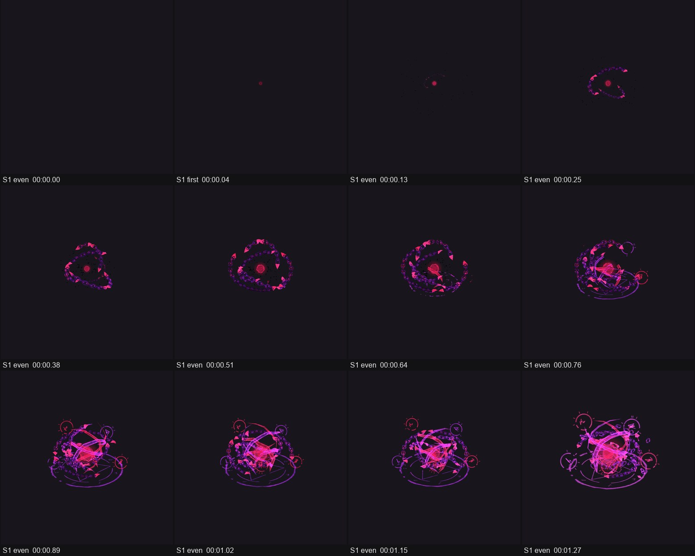
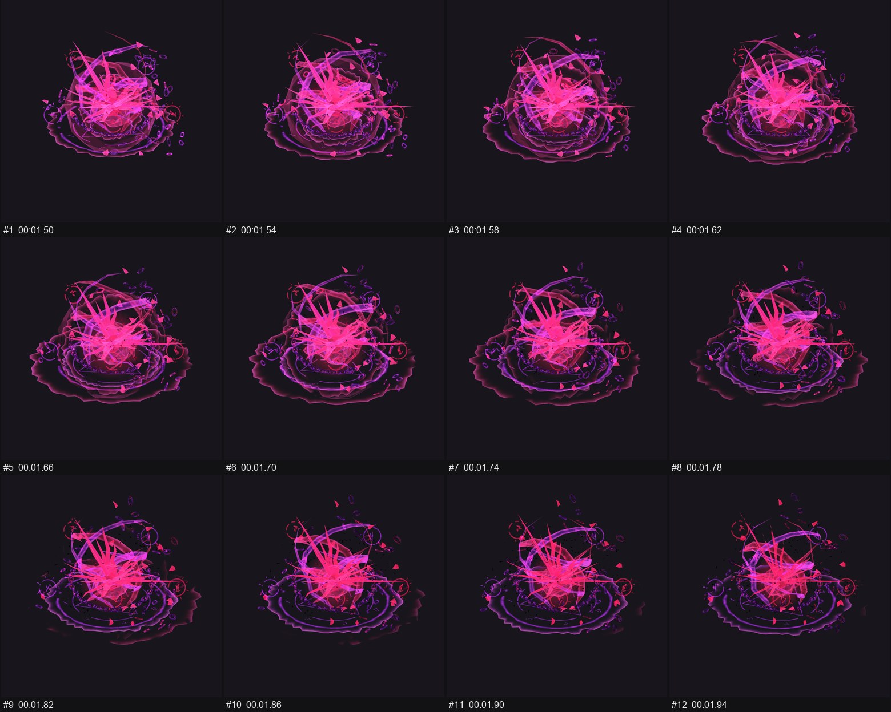

# วิเคราะห์: preview.gif (Oathbreaker Verdict)

> รายงานตัวอย่างจากการทดสอบสกิล ผมรู้ที่มาของคลิปนี้จาก README อยู่แล้ว การวิเคราะห์จึงไม่ใช่การทดสอบแบบไม่รู้เฉลย

## สรุปสั้น

เป็นเอฟเฟกต์ออร่าสไตล์เกม เล่นครั้งเดียว บนมุมมองไอโซเมตริก ผมทำซ้ำได้ประมาณ 90–95% ของคลิป (ประเมินคร่าวๆ) ส่วนที่เหลือคือแสงเรืองที่ต้องไปเติมในเอนจินเกม งานแรกที่ควรทำคือทดสอบเอฟเฟกต์กับตัวละครจริงในเกม



## ข้อมูลคลิป

| รายการ | ค่า |
|---|---|
| ขนาดและความยาว | 512×512, 2.84 วินาที, 71 เฟรม, 25 fps |
| ช็อตและกล้อง | 1 ช็อต กล้องนิ่ง |
| จังหวะภาพ | ขยับทุกเฟรม (on ones) ไม่มีการค้างภาพ |
| รูปแบบการเล่น | เริ่มและจบด้วยเฟรมว่าง จึงเป็นเอฟเฟกต์เล่นครั้งเดียว ไม่ใช่ลูป |
| เสียง | ไม่มี |
| สีเด่น | `#3c163e` `#692060` `#992471` `#bc39a5` `#db2778` `#f83eb0` |

## ในคลิปมีอะไร

| ช่วงเวลา | เกิดอะไรขึ้น | จุดที่น่าสนใจ |
|---|---|---|
| 0.00–0.50 | แกนสีแดงปรากฏ โซ่เริ่มโคจร | เริ่มจากจุดเล็กมาก ทำให้ช่วงต่อไปดูใหญ่ขึ้น |
| 0.50–1.30 | โซ่หนาขึ้น วงเวทบนพื้นและสัญลักษณ์ลอยเข้ามา | ค่อยๆ เพิ่มชั้นทีละอย่าง |
| 1.36 | การเคลื่อนไหวพุ่งขึ้นช่วงแรก | จุดปล่อยพลัง |
| 1.60–1.84 | หนามพุ่งออก คลื่นกระแทกแผ่บนพื้น | จุดปะทะ ภาพแผ่กว้างสุดราว 1.66–1.78 |
| 1.90–2.84 | เศษชิ้นส่วนกระจาย แล้วจางหาย | การจางช่วยให้จบไม่กระชาก |



## แยกชิ้นงาน

| ชิ้นงาน | น่าจะทำด้วยวิธีไหน | ความมั่นใจ | ใครทำ |
|---|---|---|---|
| แกนพลังงาน | เมชเรืองแสงที่ดิสเพลซด้วย noise | สูง | 🟢 ผมทำเอง |
| โซ่โคจร | ข้อโซ่แยกชิ้นวิ่งตามเส้นโค้ง | สูง | 🟢 ผมทำเอง |
| ริบบิ้นและหนาม | เส้นโค้งมีความหนาและเมชแหลม | สูง | 🟢 ผมทำเอง |
| วงเวทและสัญลักษณ์ | รูปทรงกราฟิกที่สร้างจากชิ้นส่วน | ปานกลาง | 🟢 ผมทำเอง |
| คลื่นกระแทกบนพื้น | วงแหวนขยายพร้อมขอบ noise | สูง | 🟢 ผมทำเอง |
| เศษชิ้นส่วน | อนุภาคจาก Geometry Nodes | ปานกลาง | 🟢 ผมทำเอง |
| แสงเรืองรอบเอฟเฟกต์ | เติมในเอนจิน คลิปนี้มีแต่แสงในตัววัสดุ | ปานกลาง | 🟡 ต้องปรับในเกม |

## สิ่งที่ผมทำได้เลย

สร้าง ปรับจังหวะ และเปลี่ยนสีได้ใน Blender ด้วยสคริปต์ แล้วส่งออกเป็น PNG พื้นโปร่งใส, sprite sheet และ GIF ตัวอย่าง

## สิ่งที่ทำได้แต่มีข้อจำกัด

แสงเรืองต้องตั้งในเอนจินจริง ผมเขียนโค้ดและค่าเริ่มต้นให้ได้ แต่คุณต้องดูผลบนหน้าจอเกมว่าสว่างพอดีไหม

## สิ่งที่อยากให้คุณช่วย

ไม่มีอะไรที่จำเป็น ผมทำต่อได้เลย มีเพียงข้อเดียวที่ช่วยให้งานดีขึ้น

### ขอ #1 — ภาพตัวละครในเกม (เสริม)

- **เหตุผล:** เพื่อเช็กขนาดเอฟเฟกต์เทียบกับตัวละครจริง
- **เครื่องมือ:** ภาพจากเกมของคุณ หรือโปรแกรมเจนภาพ เช่น Midjourney หรือ Flux
- **Prompt:**

```text
single dark fantasy warrior character, full body, isometric three-quarter view from above,
standing idle, plain light gray background, soft even lighting, no shadows, no text,
accent colors #992471 and #db2778, clean readable silhouette, game asset style
```

- **สเปก:** PNG พื้นโปร่งใสหรือพื้นเทา, ด้านยาวอย่างน้อย 1024 px, มุมกล้องเดียวกับเกม
- **บันทึกที่:** `assets/from-user/character-scale.png`
- **ถ้าไม่มี:** ผมใช้ทรงกระบอกสูง 1.8 เมตรแทน เช็กขนาดได้ แต่ไม่เห็นว่าสีเข้ากับตัวละครไหม
- **ได้แล้วผมทำต่อ:** ซ้อนเอฟเฟกต์บนตัวละคร แล้วปรับขนาดและจุดกำเนิด

## แผนงาน

1. ผมสร้างภาพทดสอบกับทรงกระบอกขนาดคน เริ่มได้เลย
2. คุณส่งภาพตัวละคร ถ้ามี
3. ผมปรับขนาด จังหวะ และส่งออก sprite sheet
4. คุณลองในเกมแล้วบอกว่าแสงเรืองพอดีไหม

## สิ่งที่ผมไม่แน่ใจ

- GIF นี้เป็น 25 fps แต่ README ระบุต้นฉบับ 24 fps และมี 72 เฟรม ความต่างนี้น่าจะมาจากข้อจำกัดของ GIF เวลาในรายงานจึงคลาดจากต้นฉบับเล็กน้อย
- GIF มีสีได้จำกัด ไฟล์ PNG ต้นฉบับจึงน่าจะมีเฉดละเอียดกว่านี้
- ภาพตัวอย่างนี้มีพื้นเข้ม ดูจาก GIF อย่างเดียวบอกความโปร่งใสจริงของต้นฉบับไม่ได้

## เลือกต่อ

อยากให้เริ่มจากการทดสอบขนาดกับตัวละคร หรือจากการปรับจังหวะช่วงปะทะก่อน?
